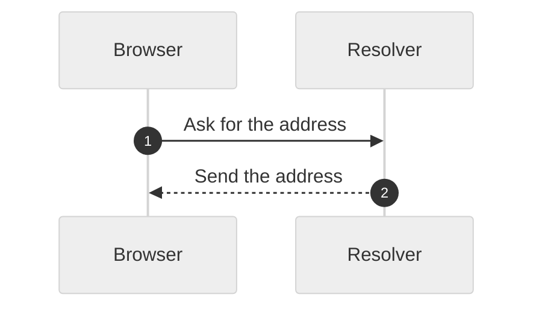

# Explain a topic

Read the arguments: an optional `--format text|diagram|html`, then the topic.
The default format is `text`. Use the chat profile, or the full profile if the
user asks for a manual or a procedure.

Clear Answer is a translation, not a summary. Give the content that the topic
needs. Only the sentences change.

## text

Follow the workflow of `/clear-answer:on` for one reply.

## Files: write once

The `diagram` format writes `<topic-slug>.md`. The `html` format writes
`<topic-slug>.html`. Put the file in the working directory, for example
`how-dns-works.md`.

1. Plan the content silently. Do not write a draft in the dialogue or in a
   file.
2. Write the file once, in plain English from the start, with the structure
   below. For `html`, write only the body content. Do not write `<html>`,
   `<head>`, CSS, or a footer.
3. Add the fixed frame. It adds the page head, the CSS, and the footer:
   ```bash
   python3 "${CLAUDE_PLUGIN_ROOT}/scripts/explain_page.py" "<file>"
   ```
4. Lint the file on disk:
   ```bash
   python3 "${CLAUDE_PLUGIN_ROOT}/scripts/ste_lint.py" --profile chat --pretty < "<file>.md"
   python3 "${CLAUDE_PLUGIN_ROOT}/scripts/ste_lint.py" --format html --profile chat --pretty < "<file>.html"
   ```
5. If `passed` is false, change only the flagged lines with small edits. Never
   write the whole file again. Lint again until `passed` is true. Do not
   delete a fact to pass the gate.
6. Fix a warning only when a one-word change fixes it.
7. Reply with exactly one sentence and the absolute path of the file. Do not
   show the file content. Do not show or summarize the linter output.
   ```
   The diagram is ready: /absolute/path/how-dns-works.md
   ```
   For a page, write "The page is ready:" instead.

## Content structure (both formats)

Use these sections, in this order, with these headings:

1. Title: "How X works". For a thing, not a process: "What X is".
2. The answer: 3 sentences or fewer.
3. The diagram, then a one-sentence caption.
4. "The parts": each part and what it does.
5. "The steps": a numbered list.
6. At most two optional sections, from this list only: "Example", "Common
   mistakes", "Safety".
7. "Limits": one short paragraph.

## diagram: the markdown file

````markdown
# How DNS works

The answer, 3 sentences or fewer.



One-sentence caption.

## The parts

| Part | What it does |
|---|---|
| Resolver | Finds the address for your computer. |

## The steps

1. The first step.

## Limits

One short paragraph.
````

Mermaid rules:

- The first line is `%%{init: {"theme": "neutral"}}%%`.
- Use `sequenceDiagram` with `autonumber` for messages between actors. Use
  `flowchart LR` for a process or a decision.
- At most 6 participants or nodes, and 12 messages.
- A label is a verb and an object, 6 words or fewer: "Ask the root server".
- Use short participant aliases: `participant R as Resolver`.

## html: the body content

```html
<h1>How DNS works</h1>
<p class="ca-answer">The answer, 3 sentences or fewer.</p>
<figure class="ca-diagram">
  <svg viewBox="0 0 760 130" role="img" aria-label="The browser asks a resolver">
    <g class="node"><rect x="20" y="40" width="150" height="56" rx="8"/><text x="95" y="68">Browser</text></g>
    <g class="node"><rect x="305" y="40" width="150" height="56" rx="8"/><text x="380" y="68">Resolver</text></g>
    <path class="edge" d="M 172 60 H 302"/>
    <text class="step" x="237" y="50">1. Ask for address</text>
    <path class="edge reply" d="M 303 76 H 173"/>
    <text class="step" x="237" y="96">2. Send address</text>
  </svg>
  <figcaption>One sentence.</figcaption>
</figure>
<h2>The parts</h2>
<dl><dt>Resolver</dt><dd>Finds the address for your computer.</dd></dl>
<h2>The steps</h2>
<ol><li>The first step.</li></ol>
<h2>Limits</h2>
<p>One short paragraph.</p>
```

SVG rules:

- Use only the classes `node`, `edge`, `edge reply`, and `step`. Do not set
  colors, fonts, or sizes. The frame CSS styles them in light and dark mode.
- A box is 150 by 56, with its label centered, 3 words or fewer, on one line.
  Put boxes in a row from left to right, 135 apart. When one box talks to
  several, put the others in a column on the right.
- A request arrow runs 8 above the center of the boxes. Its answer is a
  `reply` arrow 8 below the center. Arrows do not cross.
- A step label is a number, a verb, and an object: "2. Ask root server". Put
  it above a request arrow or below a reply arrow, never on a box or a line.
- At most 6 boxes and 8 steps.
- The page must work with no network. Do not load scripts, fonts, styles, or
  images from a URL.
