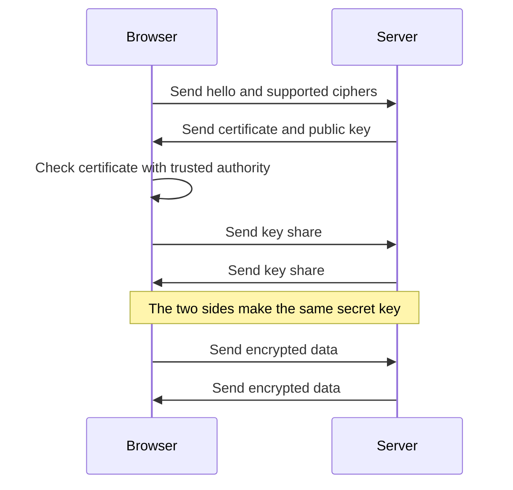
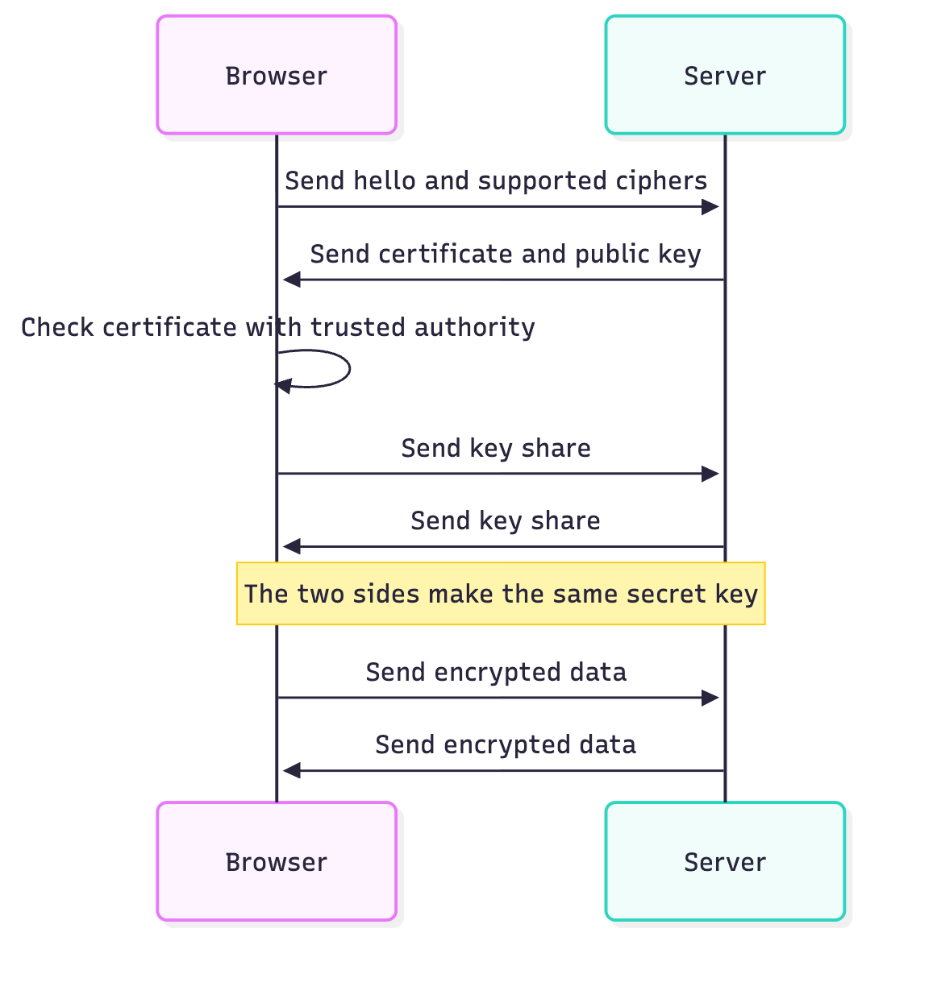

# 11. Explain a topic with a diagram

`/clear-answer:explain --format diagram` gives a short explanation and one
Mermaid diagram. The linter checks the text and every label in the diagram.

## Run it

1. Open Claude Code with the plugin installed.
2. Run:
   ```
   /clear-answer:explain --format diagram How does HTTPS keep a connection private?
   ```

## What you get

This is a real reply from Claude Sonnet, saved in
[`examples/explain-https-diagram.md`](examples/explain-https-diagram.md):

````markdown
HTTPS keeps a connection private with encryption. The browser and the server first agree on a secret key. Then they use that key to lock all data.



The certificate proves who the server is. The secret key never crosses the network. An attacker who reads the traffic sees only scrambled data.
````

GitHub, many editors, and Claude Desktop show the diagram as a picture. The
Mermaid CLI (`mmdc`) gave this image:



## What the gate checks

- The text gets all the usual rules.
- Each node label, edge label, and sequence message gets the word rules: simple
  tenses, no contractions, and approved words.
- A label of more than 8 words is an error (`label-length`).
- The linter reads `flowchart`, `graph`, and `sequenceDiagram` diagrams. In
  other diagram types, it does not read the labels.

Check a reply yourself:

```bash
python3 scripts/ste_lint.py --profile chat --pretty < docs/tutorials/examples/explain-https-diagram.md
```

The result is `"passed": true` with no violations.

## What the gate does not check

The gate checks words, not drawings. It does not check that the arrows are in
the correct order or that the diagram is correct. Read the diagram before you
share it.

## Render the diagram to an image (optional)

```bash
npx -p @mermaid-js/mermaid-cli mmdc -i diagram.mmd -o diagram.png -b white
```

This downloads the Mermaid CLI and a browser the first time.
