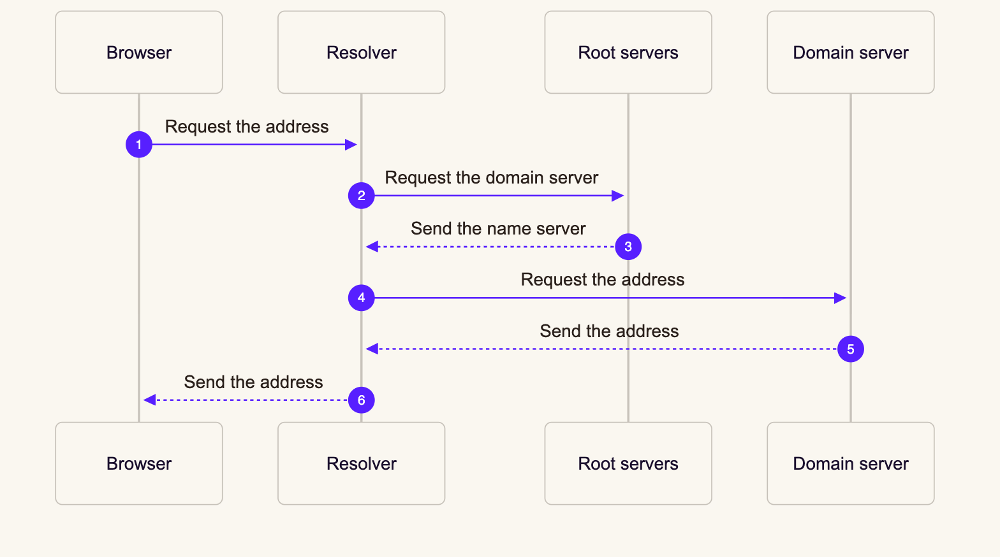

# 11. Explain a topic with a diagram

`/clear-answer:explain:diagram` writes a Markdown file with a short answer, one
Mermaid diagram, and fixed sections. The dialogue shows only a link to the file.

## Run it

1. Open Claude Code with the plugin installed.
2. Run:
   ```
   /clear-answer:explain:diagram How does DNS work?
   ```
3. Claude replies with one sentence and the path of the file:
   ```
   The diagram is ready: /Users/you/project/how-dns-works.md
   ```

## What Claude does

Claude does not write Markdown or Mermaid. It fills named blanks in a small
content file, and a script builds the file.

1. Claude passes the blanks to `scripts/explain_build.py` in one shell
   command. The script saves them to `how-dns-works.clear.txt`.
2. The script checks the structure and lints each blank. It reports only the
   errors, each with the name of its blank, such as "step 3".
3. If there is an error, Claude replaces only that blank with `--set`, in one
   more shell command.
4. When the build passes, the script writes `how-dns-works.md`, with the
   Mermaid diagram and the footer.

Claude uses shell commands only, so the dialogue shows one collapsed command
and no file diffs. In a real run with Claude Sonnet on a new topic, this took
one command and 621 output tokens.

The real content file is
[`examples/explain-dns-diagram.clear.txt`](examples/explain-dns-diagram.clear.txt).
The built file is
[`examples/explain-dns-diagram.md`](examples/explain-dns-diagram.md).

## The content file

```text
title: How DNS works
answer: The answer, in 3 sentences or fewer.
actor B: Browser
actor R: Resolver
B -> R: Ask for the address
R --> B: Send the address
caption: One sentence about the diagram.
part: Resolver | Finds the address for your computer.
step: The browser asks the resolver for the address.
limits: One short paragraph.
```

- The diagram is always actors that send messages. For a process, each stage
  is an actor that hands the work to the next one.
- `->` is a request, and `-->` is a reply.
- The full list of blanks is in the command, `commands/explain/diagram.md`.

## What you get

Each file has the same sections, in the same order, and the same kind of
diagram, in the Stayux colors. They are the title, the
answer, the diagram and its caption, "The parts" as a table, "The steps", and
"Limits". The Mermaid CLI (`mmdc`) gave this image of the real diagram:



The diagram shows as a picture only in a viewer that supports Mermaid, such as
Obsidian or GitHub. MacDown shows the Mermaid code instead.

## Build the other format

The content file stays in the folder. To make an HTML page from the same
content, with no new request to Claude:

```bash
python3 scripts/explain_build.py how-dns-works.clear.txt --to html
```

## The footer

Each file ends with the Stayux Clear Answer footer, centered, with links to
Stayux.com, LinkedIn, and X.com. The script adds it, so the linter does not
check it. Some viewers, such as GitHub, remove the `target` attribute, so there
the links open in the same tab.
