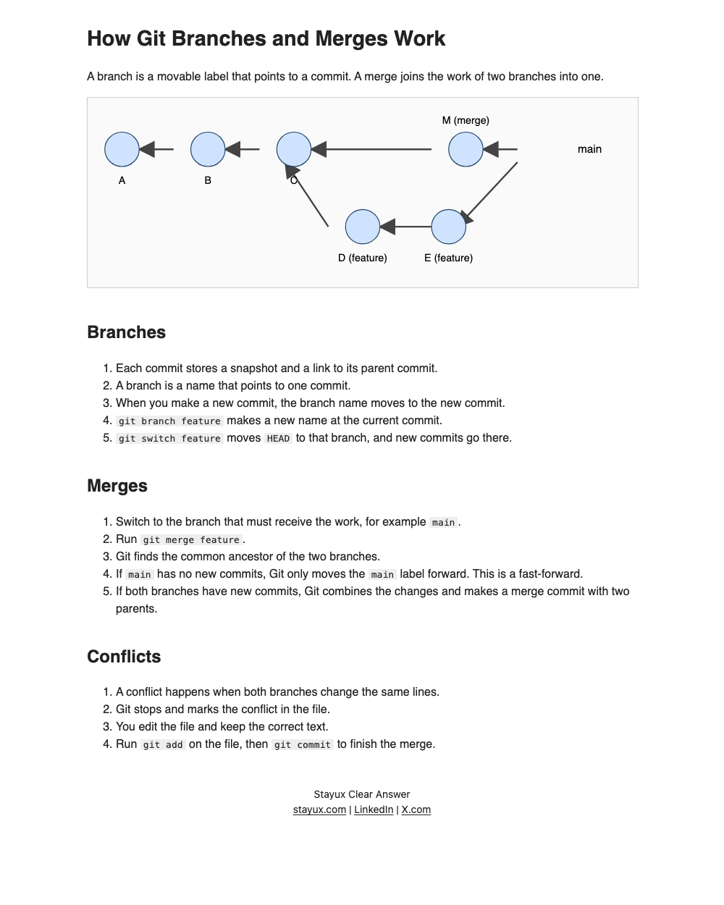

# 12. Explain a topic as an HTML page

`/clear-answer:explain --format html` writes one HTML file that works with no
network. The page has an introduction, a diagram, and step-by-step sections.
The linter checks every word that a reader sees.

## Run it

1. Open Claude Code with the plugin installed, in the folder for the page.
2. Run:
   ```
   /clear-answer:explain --format html How do Git branches and merges work?
   ```
3. Claude writes the file, for example `git-branches-and-merges.html`, and
   replies with its path.

## What you get

This is a real page from Claude Sonnet, saved in
[`examples/explain-git-page.html`](examples/explain-git-page.html). This is the
page in a browser with the network blocked:



All styles are in the page. The diagram is inline SVG, so the page needs no
script and no network.

## What the gate checks

Check the page yourself:

```bash
python3 scripts/ste_lint.py --format html --profile chat --pretty < docs/tutorials/examples/explain-git-page.html
```

- Only visible text is checked. The linter skips the head, scripts, styles, and
  code, such as `git merge feature`.
- Each paragraph, list item, and table cell is checked on its own.
- Text in the SVG diagram is checked as labels, with a limit of 8 words.
- A page that loads a script, style, font, or image from the network fails
  with `external-request`. A link to another page is fine.

The result for this page is `"passed": true`, with some warnings. The linter
checks each word by its part of speech. "Open the file" passes, because "file"
is a noun there. With an imported official dictionary, the warnings point to
verbs that STE does not approve, such as "switch" and "run". Two short SVG
labels, "D (feature)" and "main", have no context, so the linter cannot tell
that they are nouns. It warns, and the warning names the part of speech.

## What the gate does not check

The gate checks words, not drawings. In this real page, one arrow starts at an
empty place near the "main" label, and one arrowhead covers the "C" label. The
words pass, but the drawing has errors. Open the page and look at the diagram
before you share it.

## Open the page with no network

To confirm that the page works offline, open it with the network turned off.
All text, styles, and the diagram must show.
