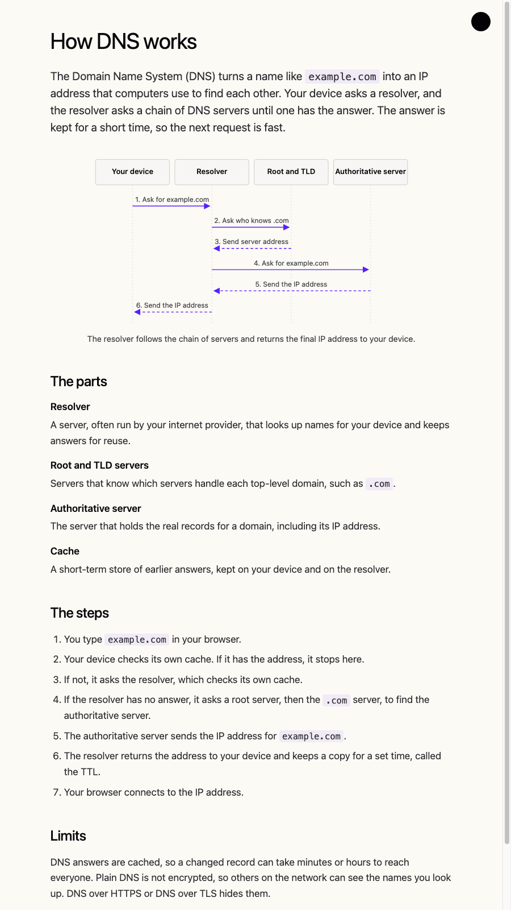
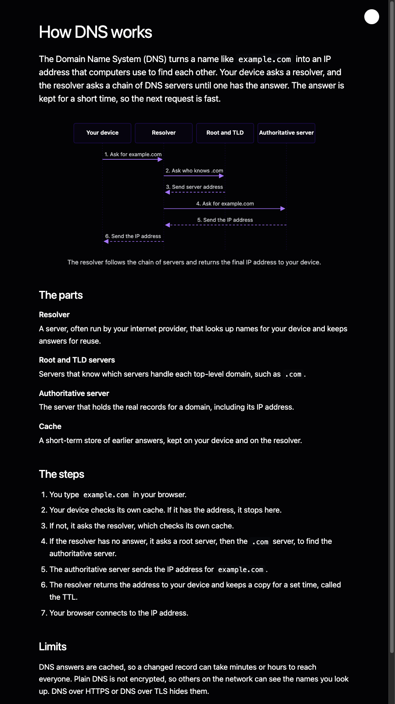

# 12. Explain a topic as an HTML page

`/clear-answer:explain:html` writes one HTML page that works with no network.
The page uses the Stayux design system, in light and dark mode. The dialogue
shows only a link to the file.

## Run it

1. Open Claude Code with the plugin installed, in the folder for the page.
2. Run:
   ```
   /clear-answer:explain:html How does DNS work?
   ```
3. Claude replies with one sentence and the path:
   ```
   The page is ready: /Users/you/project/how-dns-works.html
   ```

## What Claude does

Claude does not write HTML, CSS, or SVG. It fills the same content file as the
diagram command (see tutorial 11), and a script builds the page.

1. Claude passes the blanks to `scripts/explain_build.py` in one shell
   command. The script saves them to `how-dns-works.clear.txt`.
2. The script lints each blank and reports only the errors.
3. If there is an error, Claude replaces only that blank with `--set`, in one
   more shell command.
4. When the build passes, the script writes the page. It adds the frame, the
   CSS, the SVG diagram, the theme switch, and the footer.

Claude uses shell commands only, so the dialogue shows no file diffs. In a real
run with Claude Sonnet on a new topic, this took one command and 715 output
tokens.

## What you get

The real content file is
[`examples/explain-dns-page.clear.txt`](examples/explain-dns-page.clear.txt),
and the page is
[`examples/explain-dns-page.html`](examples/explain-dns-page.html). This is
the page in a browser with the network blocked:



The page follows the system theme. This is the dark mode:



The circle at the top right switches between light and dark, like the switch
on stayux.com. The page keeps the choice for the next visit. With no choice,
the page follows the system theme.

## The diagram

The script draws the diagram from the content file, so every page looks the
same:

- The actors are boxes in a row at the top, with a dotted line down from each
  box.
- Each message is a numbered horizontal arrow with its label above it.
  Replies are dashed. Arrows do not cross.
- Every page uses this one kind of diagram. The Markdown file shows the same
  diagram as a Mermaid sequence diagram, in the same colors.

The colors and the box corners come from the Stayux design system. The text
uses the system font.

## What the gate checks

- Each blank is checked on its own: the text with the usual rules, the labels
  with the word rules and a limit of 8 words.
- The script checks the structure, for example 3 sentences or fewer in the
  answer, and 2 to 5 actors.
- The frame, the CSS, and the footer are not checked, because the script adds
  them.
- The page loads nothing from the network.

To see the warnings too, run the linter on the page:

```bash
python3 scripts/ste_lint.py --format html --pretty < docs/tutorials/examples/explain-dns-page.html
```

## The footer

The page ends with the Stayux Clear Answer footer. It is centered, in a 14 px
system font. The links are underlined, change color on hover, and open in a new
tab.
