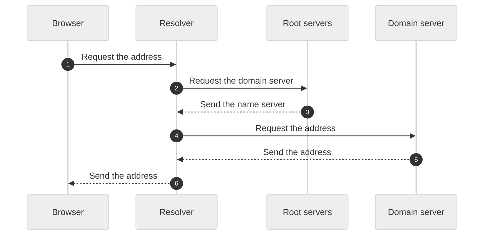

# How DNS works

DNS turns a name, such as `example.com`, into an IP address. Your computer asks a resolver, and the resolver asks other name servers until it finds the address. The resolver then keeps a copy for a short time.

The resolver asks each level of servers until it finds the address for the browser.

## The parts

| Part | What it does |
|---|---|
| Resolver | Finds the address for your computer and keeps a copy. |
| Root servers | Point the resolver to the servers for a domain. |
| Domain server | Keeps the records for a domain and gives the last address. |

## The steps

1. The browser asks the resolver for the address of a name.
2. The resolver asks the root servers which name server holds the domain.
3. The resolver asks that name server for the address.
4. The resolver sends the address to the browser, and the browser connects.

## Example

You type `www.example.com` in the browser. The resolver learns the address, such as `93.184.216.34`, and the browser connects to it.

## Limits

The resolver keeps a copy for a set time, called the TTL, so a change to a record can be slow to get to everyone.

---

Stayux Clear Answer 
<a href="https://stayux.com" target="_blank" rel="noopener noreferrer">Stayux.com</a> | <a href="https://www.linkedin.com/in/stayu-kasabov-stayux/" target="_blank" rel="noopener noreferrer">LinkedIn</a> | <a href="https://x.com/StayuKasabov" target="_blank" rel="noopener noreferrer">X.com</a>

