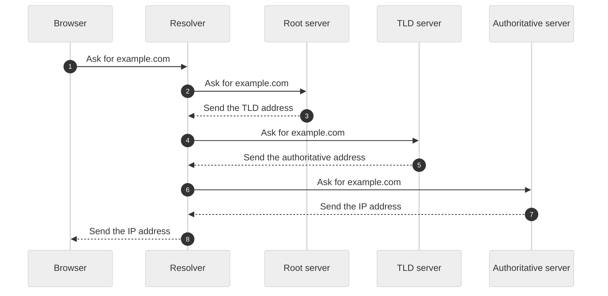

# How DNS works

DNS turns a name, such as example.com, into an IP address. Your computer asks a resolver. The resolver asks other servers in order until it gets the address.

The resolver asks three servers in turn, then gives the IP address to the browser.

## The parts

| Part | What it does |
|---|---|
| Browser | Needs the IP address of a site. |
| Resolver | Finds the address for your computer and keeps a copy for later. |
| Root server | Tells the resolver which server handles the end of the name, such as .com. |
| TLD server | Tells the resolver which server holds the records for the domain. |
| Authoritative server | Holds the real records and gives the IP address. |

## The steps

1. The browser asks the resolver for the address of example.com.
2. The resolver checks its cache. If it has the address, it answers now.
3. The resolver asks a root server.
4. The root server sends the address of the .com TLD server.
5. The resolver asks the TLD server.
6. The TLD server sends the address of the authoritative server.
7. The resolver asks the authoritative server.
8. The authoritative server sends the IP address.
9. The resolver saves the address and sends it to the browser.

## Common mistakes

- People think DNS is one big list on one server. It is a tree of many servers.
- People think a change shows at once. Caches keep old answers until the time to live ends.

## Limits

This is the basic path. Real DNS also has other record types, security checks such as DNSSEC, and encrypted lookups. The steps change a little when a cache already holds part of the answer.

---

Stayux Clear Answer 
<a href="https://stayux.com" target="_blank" rel="noopener noreferrer">Stayux.com</a> | <a href="https://www.linkedin.com/in/stayu-kasabov-stayux/" target="_blank" rel="noopener noreferrer">LinkedIn</a> | <a href="https://x.com/StayuKasabov" target="_blank" rel="noopener noreferrer">X.com</a>

