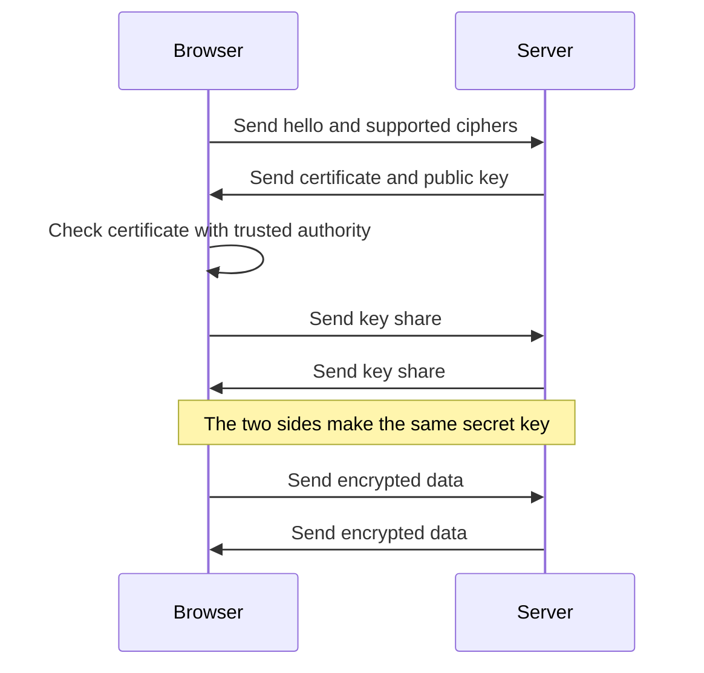

HTTPS keeps a connection private with encryption. The browser and the server first agree on a secret key. Then they use that key to lock all data.

The certificate proves who the server is. The secret key never crosses the network. An attacker who reads the traffic sees only scrambled data.