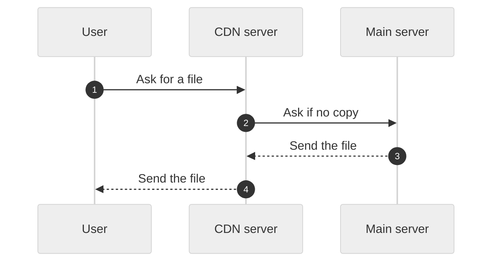

# How a CDN works

A content delivery network (CDN) keeps copies of your files on servers near your users. A user gets a file from a near server, not from your main server. The page loads faster, and your main server gets less traffic.

The CDN server asks the main server only when it has no copy.

## The parts

| Part | What it does |
|---|---|
| CDN server | A server near the user that keeps copies of your files. |
| Main server | Your own server. It has the original files. |

## The steps

1. The user asks for a file, such as an image.
2. The request goes to the nearest CDN server.
3. If that server has a copy, it sends the copy to the user.
4. If it has no copy, it gets the file from the main server. It keeps a copy for the next request.

## Limits

A CDN helps most with files that do not change often. For data that changes for each user, the CDN must ask the main server each time.

---

Stayux Clear Answer 
<a href="https://stayux.com" target="_blank" rel="noopener noreferrer">Stayux.com</a> | <a href="https://www.linkedin.com/in/stayu-kasabov-stayux/" target="_blank" rel="noopener noreferrer">LinkedIn</a> | <a href="https://x.com/StayuKasabov" target="_blank" rel="noopener noreferrer">X.com</a>

