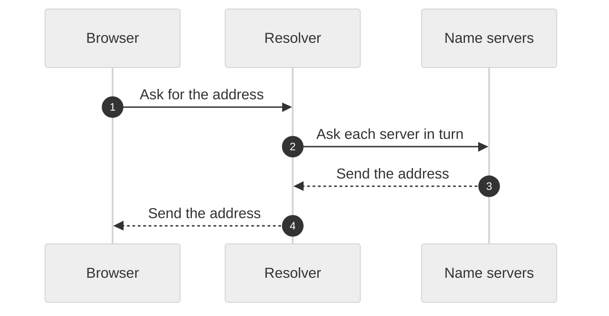

# How DNS works

DNS changes a name, such as `example.com`, into an IP address. Your computer asks a resolver. The resolver asks other servers until it finds the address.

The resolver asks other servers only when its cache has no answer.

## The parts

| Part | What it does |
|---|---|
| Resolver | Finds the address for your computer. |
| Name servers | Keep the records for each domain. |

## The steps

1. The browser asks the resolver for the address.
2. The resolver asks the name servers, one after the other.
3. The last server sends the address.
4. The resolver sends the address to the browser and keeps a copy.

## Limits

The resolver keeps a copy for a set time. A change to a record can take that long to reach all users.

---

Stayux Clear Answer 
<a href="https://stayux.com" target="_blank" rel="noopener noreferrer">Stayux.com</a> | <a href="https://www.linkedin.com/in/stayu-kasabov-stayux/" target="_blank" rel="noopener noreferrer">LinkedIn</a> | <a href="https://x.com/StayuKasabov" target="_blank" rel="noopener noreferrer">X.com</a>

